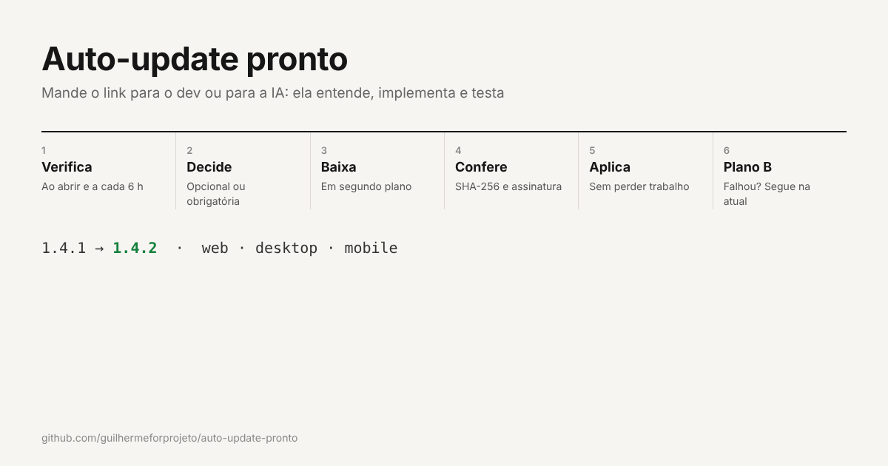

# Auto-update ready

**A complete auto-update spec for web, desktop and mobile. Send the link to your developer or your AI: it detects the project's platform, picks the right tool, implements it with integrity checks and tests it against a checklist.**

[🇧🇷 Português](README.md) | 🇺🇸 English



---

## Easiest way: send the link

**To your AI** (Claude Code, Cursor, Codex), opened in your project folder:

```text
Read https://github.com/guilhermeforprojeto/auto-update-pronto and follow AGENTS.md to implement auto-updates in this project.
```

**To a developer:** send the link, or open an issue using the template in [`.github/ISSUE_TEMPLATE/auto-updater.md`](.github/ISSUE_TEMPLATE/auto-updater.md).

All files are in Portuguese; AI agents follow them fine.

## The flow in 6 steps

1. **Check** on launch and every 6 h (web: also when the tab regains focus).
2. **Decide** optional vs mandatory using the manifest's `minVersion`.
3. **Download** in the background without freezing the UI.
4. **Verify** SHA-256 and the signature before applying; mismatches are discarded.
5. **Apply** without losing work: "Restart to update" on desktop; a subtle banner on the web that never reloads over an open form.
6. **Fallback:** any failure keeps the current version running and retries later.

## Tools by platform

| Platform | Recommended |
|---|---|
| Website / SPA / PWA | Hashed assets + `version.json`, or a Service Worker in "prompt" mode (Workbox, `vite-plugin-pwa`) |
| Electron | `electron-updater` |
| Tauri | Official `updater` plugin (signed) |
| .NET, C++, Rust, packaged Python | Velopack |
| Windows MSIX | `.appinstaller` |
| Native macOS | Sparkle |
| Android | Google Play in-app updates + OTA |
| iOS | Prompt linking to the App Store + OTA |
| OTA for React Native / Expo | EAS Update |
| OTA for Flutter | Shorebird |

> **App Center CodePush was retired in 2025.** Don't use it in new projects.

## Non-negotiable security

HTTPS everywhere · SHA-256 always, digital signatures on desktop · signing keys **only in CI**, never in the repo or the app · never install a lower version than the current one.

If this helped, a ⭐ helps others find it.

## License

[CC BY 4.0](LICENSE): use, copy, adapt and redistribute freely, commercially too. Just credit the source with a link to this repo.
