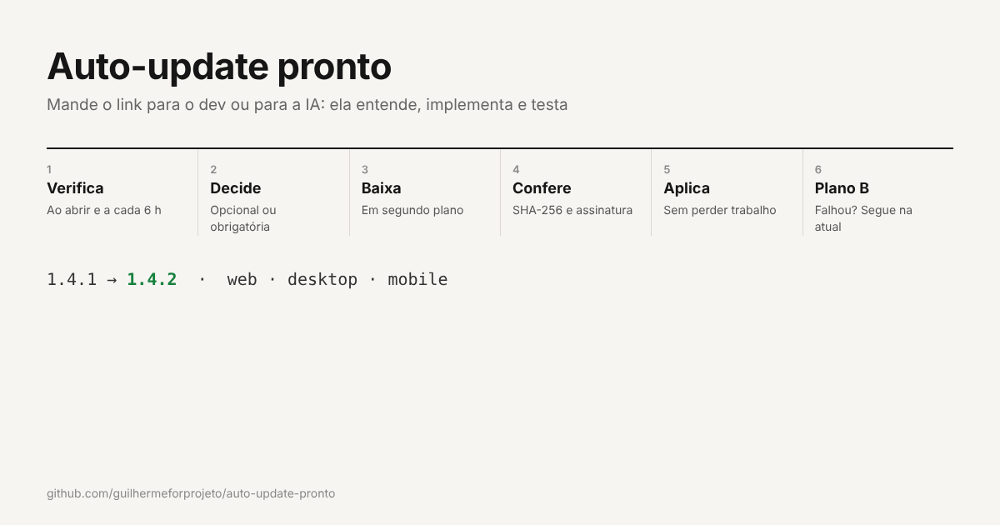

# Auto-update pronto

**Especificação completa de atualização automática para web, desktop e mobile. Mande o link para o seu dev ou para a IA: ela descobre a plataforma do projeto, escolhe a ferramenta certa, implementa com verificação de integridade e testa contra um checklist.**

🇧🇷 Português | [🇺🇸 English](README.en.md)



---

## Jeito mais fácil: mande o link

**Para a IA** (Claude Code, Cursor, Codex), aberta na pasta do seu projeto:

```text
Leia https://github.com/guilhermeforprojeto/auto-update-pronto e siga o AGENTS.md para implementar atualização automática neste projeto.
```

**Para um dev:** mande o link ou abra uma issue com o modelo pronto em [`.github/ISSUE_TEMPLATE/auto-updater.md`](.github/ISSUE_TEMPLATE/auto-updater.md). Copie esse arquivo para o `.github/ISSUE_TEMPLATE/` do seu repositório e ele aparece como opção em "New issue".

## O que tem aqui

| Arquivo | Para quê |
|---|---|
| [`AGENTS.md`](AGENTS.md) | Roteiro para a IA: entender o projeto, propor a ferramenta, esperar seu OK, implementar, testar e entregar |
| [`SPEC.md`](SPEC.md) | A especificação: fluxo, manifesto de versão, requisitos de segurança e critérios de aceite |
| [`CHECKLIST.md`](CHECKLIST.md) | Testes para marcar no PR, com evidência |
| [`plataformas/web.md`](plataformas/web.md) | Site, SPA e PWA: cache, Service Worker e aviso de nova versão |
| [`plataformas/desktop.md`](plataformas/desktop.md) | Electron, Tauri, .NET (Velopack), MSIX e macOS (Sparkle) |
| [`plataformas/mobile.md`](plataformas/mobile.md) | Loja (in-app updates) e OTA (EAS Update, Shorebird) |
| [`exemplos/version.json`](exemplos/version.json) | Modelo do manifesto de versão |

## O fluxo em 6 passos

1. **Verifica** ao abrir e a cada 6 h (web: também ao voltar para a aba).
2. **Decide** se é opcional ou obrigatória pelo `minVersion` do manifesto.
3. **Baixa** em segundo plano, sem travar a tela.
4. **Confere** o SHA-256 e a assinatura antes de aplicar. Arquivo diferente é descartado.
5. **Aplica** sem perder trabalho: "Reiniciar para atualizar" no desktop; aviso discreto na web, que nunca recarrega com formulário aberto.
6. **Plano B:** qualquer falha mantém a versão atual funcionando e tenta de novo depois.

## Ferramentas por plataforma

| Plataforma | Recomendado |
|---|---|
| Site / SPA / PWA | Hash nos arquivos + `version.json` ou Service Worker em modo "prompt" (Workbox, `vite-plugin-pwa`) |
| Electron | `electron-updater` |
| Tauri | Plugin oficial `updater` (com assinatura) |
| .NET, C++, Rust, Python empacotado | Velopack |
| Windows MSIX | `.appinstaller` |
| macOS nativo | Sparkle |
| Android | In-app updates do Google Play + OTA |
| iOS | Aviso com link para a App Store + OTA |
| OTA React Native / Expo | EAS Update |
| OTA Flutter | Shorebird |

> O **CodePush do App Center foi descontinuado em 2025**. Não use em projeto novo.

## Segurança, sem negociação

- HTTPS em tudo.
- SHA-256 sempre e assinatura digital no desktop.
- A chave privada de assinatura fica **só no CI**, nunca no repositório nem no app.
- Nunca instala versão menor que a atual.

## Mais da série

[claude-estudio-de-voz](https://github.com/guilhermeforprojeto/claude-estudio-de-voz) · [claude-artista-3d](https://github.com/guilhermeforprojeto/claude-artista-3d) · [claude-web-designer](https://github.com/guilhermeforprojeto/claude-web-designer) · [seguranca-antes-de-lancar](https://github.com/guilhermeforprojeto/seguranca-antes-de-lancar) · [valide-antes-de-programar](https://github.com/guilhermeforprojeto/valide-antes-de-programar) · [web-moderna-para-ia](https://github.com/guilhermeforprojeto/web-moderna-para-ia) · [dashboard-sem-cara-de-ia](https://github.com/guilhermeforprojeto/dashboard-sem-cara-de-ia)

Se isso te ajudou, deixa uma ⭐. Ajuda mais gente a achar.

## Licença

[CC BY 4.0](LICENSE): use, copie, adapte e redistribua à vontade, inclusive comercialmente. Só cite a fonte, com um link para este repositório.
